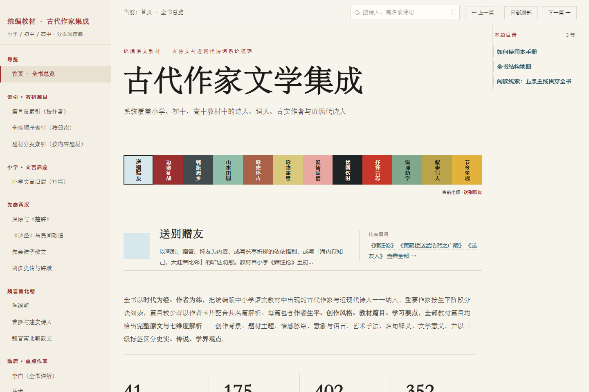
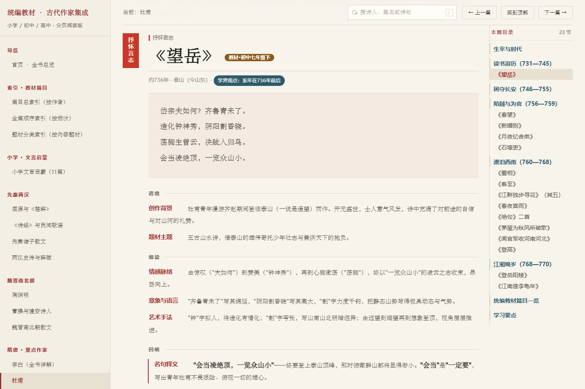
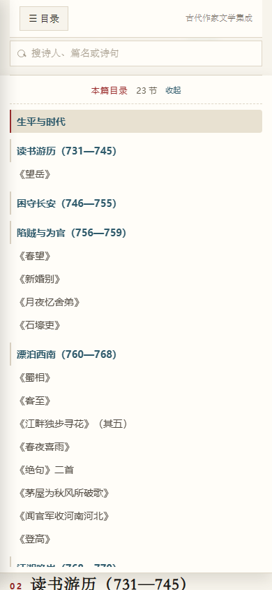
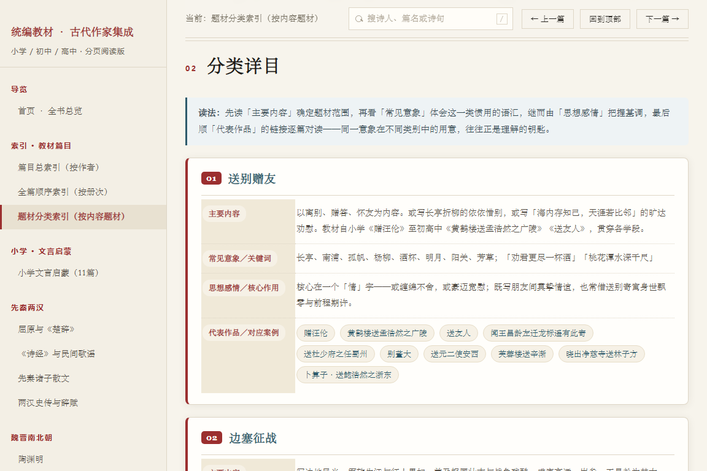
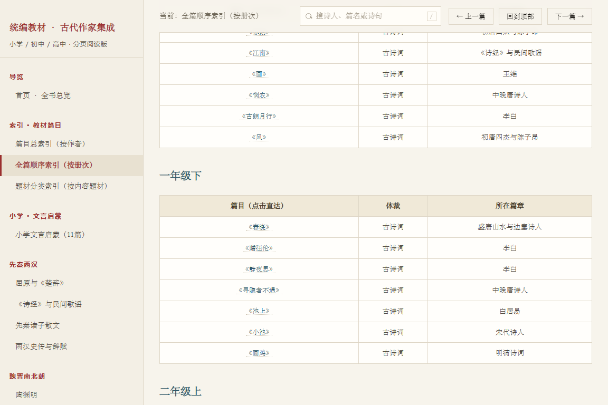
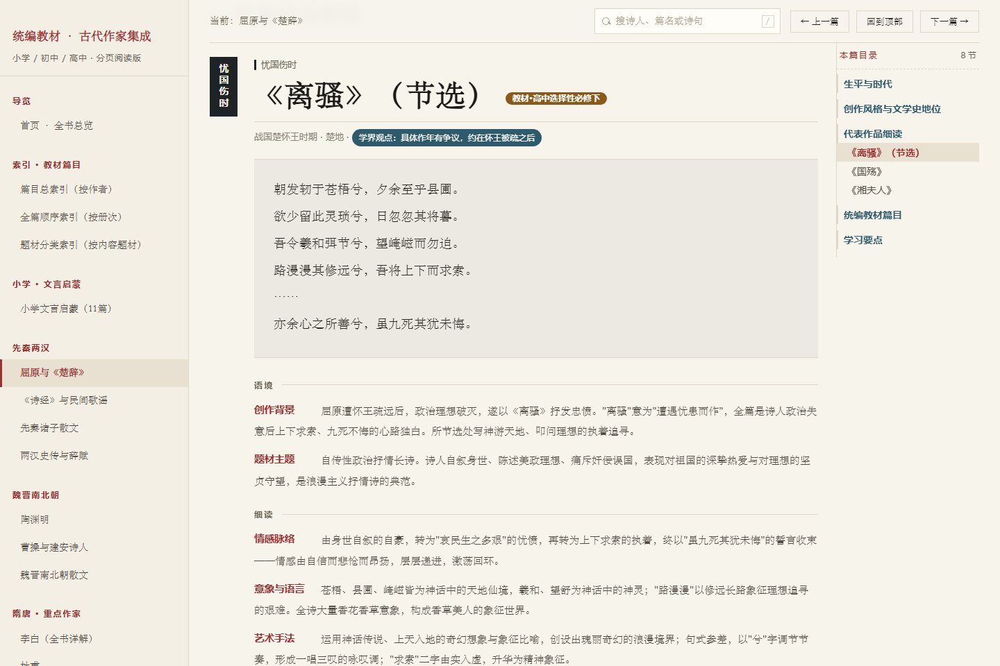

<div align="center">

# 统编教材古代作家文学集成

> *「一个文件。402 篇。七维解析。」*

[](docs/index.html)
[](docs/index.html)
[](docs/index.html)
[](docs/index.html)

<br>

**双击一个文件，从小学读到高中。**

[先看效果](#先看效果) · [它是什么](#它是什么) · [在线版](#在线版) · [三个用法](#三个用法) · [构建](#构建)

</div>

---

## 先看效果

<p align="center"></p>
<p align="center"><sub>首页 · 三篇索引、全局检索与十二题材色带都在第一屏</sub></p>

<p align="center"></p>
<p align="center"><sub>作品页 · 原文完整呈现，七维解析按语境／细读／回响三组展开</sub></p>

<p align="center"></p>
<p align="center"></p>
<p align="center"><sub>左：手机端本篇目录固定在顶部，随滑动不消失　右：题材分类索引逐类拆解</sub></p>

---

## 它是什么

这不是诗文汇编，而是「作者生平 — 教材篇目 — 作品全文 — 系统解析」四层合一的学习手册。

- **作者生平**：重点作家按人生阶段分块，先交代处境与时代背景，再紧接该阶段写下的作品，让诗与人互相印证。
- **教材篇目**：每篇标注学段与册次，附教材条目直达，便于随课查阅。
- **作品全文**：402 篇原文完整呈现，附名句释义与文学史定位。
- **七维解析**：创作背景、题材主题、情感脉络、意象与语言、艺术手法、名句释义、文学意义——七个视角逐层拆解一首作品。

一个 HTML 文件装下全部内容，无外部依赖、无需联网，双击即读。

## 在线版

- GitHub Pages：<https://ttbingo.github.io/ancient-literature-anthology/>
- WorkBuddy 在线版：https://libai-poetry-analysis.app.workbuddy.host/?sharecode=OW43ZWFJ4B

想先看一眼，直接用上面的链接；想离线留存，下载 [docs/index.html](docs/index.html) 即可。

## 能做什么

| 规模 | 数量 | 读者能得到什么 |
|---|---|---|
| 分页 | 41 | 一部可按作者、按册次、按题材三种方式进入的文学史 |
| 作品全文与解析 | 402 | 从小学到高中统编教材的古诗文与近现代诗词，一篇不漏 |
| 作者卡 | 175 | 每位作者有独立的篇目清单与站内直达 |
| 解析维度块 | 2781 | 每首作品七个视角，读完之后知道它好在哪 |
| 站内跳转链接 | 1403（0 坏链） | 索引、目录、正文之间一步到位 |
| 题材分类 | 12 类 | 送别、边塞、羁旅、山水、怀古、咏物……按情感基调找作品 |

---

## 三个用法

### 按课查诗

> 「明天讲《望岳》，先看看它怎么写、为什么这么写。」

从全篇顺序索引按册次找到篇目，点篇名直达全文与解析。教材篇目一览、重点作家速查、选修专题同样可点。

<p align="center"></p>

### 顺读文学史

> 「屈原到辛弃疾，这一路是怎么走过来的？」

按时代为经、作者为纬，一路顺读即是一部文学史。重点作家单页按生平阶段分块，先讲处境，再读那个阶段写下的诗。

<p align="center"></p>

### 按题材找

> 「想找几首写送别的，看看古人都怎么劝朋友。」

题材分类索引把 402 篇按 12 类重整，每类列主要内容、常见意象、思想感情与代表作品；全书每篇配对应题材色标，翻页时也不迷失。

<p align="center"></p>

---

## 编排与导航

- **按时代为经、作者为纬**：先秦、两汉、魏晋南北朝、初唐、盛唐、中晚唐、两宋诗词与散文、元曲、明清诗文、古代白话小说、近现代诗词、选修专题，一路顺读即是一部文学史。
- **重点作家单页**：李白、杜甫、苏轼、李清照、辛弃疾等按生平阶段分块；篇目较少的作者合页呈现，作者卡下列出教材篇目并做站内直达。
- **三篇索引**：篇目总索引（按作者与学段）、全篇顺序索引（按册次，小学一上到高中选必下）、题材分类索引（12 类，每类列主要内容／常见意象／思想感情／代表作品）。从索引点进作品再返回，自动回到点击处的段落。
- **附录速查**：教材篇目一览、重点作家篇目速查、选修专题、白话小说九篇等，表内篇目全部可点。
- **全局检索**：顶栏搜索框支持诗人、篇名、诗句、字号别称，输入即出结果并定位。

## 阅读功能

**定位与检索**

- **本篇目录**：每页自动生成独立目录，随阅读滚动高亮当前小节，点条目即跳转；手机上点开后固定在屏幕顶部、随滑动不消失，点别处自动收起。
- **顺序阅读与深链**：顶部「上一篇／下一篇」与键盘左右方向键翻页；每页可深链直达，URL 即读到这里。
- **十二题材色标**：每篇按题材着色，色带与篇目标识一致，便于按情感基调辨识与检索。

**解析与阅读**

- **七维分组**：解析按「语境／细读／回响」三组呈现，还原先背景、再文本、后沉淀的阅读顺序。
- **名句加粗**：跨篇复现的名句在解析中统一加粗突出，回响组以细线落点收束。
- **五线阅读地图**：以历史转折、士人出处、文章之道、诗词流变、题材意趣五条线索串讲，同一作家可落在多条线上。
- **标签分级**：教材、史实、传说、学界观点四类标签区分资料性质，争议处标明出处供查考。

**视觉与适配**

浅纸底、衬线正文、细线分隔的杂志式排版；解析区保留紧凑横排，长文也能一口气读完。桌面端左侧全局目录、右侧本篇目录双栏定位；手机端折叠为顶栏 ☰ 目录按钮，顶部导航与搜索常驻，正文与浮层目录互不干扰。

## 边界与说明

- 这是学习辅助性质的系统梳理，不是教材的官方配套资源。教材篇目依据统编版常见目录整理，不同印次、地区与年份的选篇会有出入。
- 涉及生卒、系年与作品归属的争议均以标签标明，供进一步查考，详见成品中的「编例与说明」页。
- 部分文言文、现代诗与白话小说篇目尚未与外部诗词库逐字对齐，引用时请以权威底本为准。
- 单文件离线是本项目的取舍：内容自带、不依赖运行时接口，因此没有注音、朗读、背诵练习等需要外部数据或音频的能力。

---

## 目录结构

```
docs/index.html            成品（发布用，可直接 GitHub Pages）
parts/                     分页源文件（每页一个 html 片段）
parts/build.py             构建脚本：拼页 + 注入 CSS/JS + 生成目录与检索索引
parts/skin.css / skin.js   视觉皮肤与运行时交互（色标、色带、分组、目录）
audit/                     结构校验与 Playwright 版面回归脚本
audit/review/              本文档所用截图
xuanxiu/                   选修页生成器
novel/                     古代白话小说生成器
design-demos/              视觉讨论稿与预览
```

## 构建

```bash
python parts/build.py
cp 统编教材古代作家文学集成.html docs/index.html
```

`build.py` 按顺序拼接 `parts/*.html`，校验分页数量与冗余片段，统一注入皮肤样式与交互脚本，生成每页的本篇目录与检索索引。

---

这不是一个 App。是一个文件——打开它，402 篇作品和它们的来龙去脉都在里面，不联网也在。
